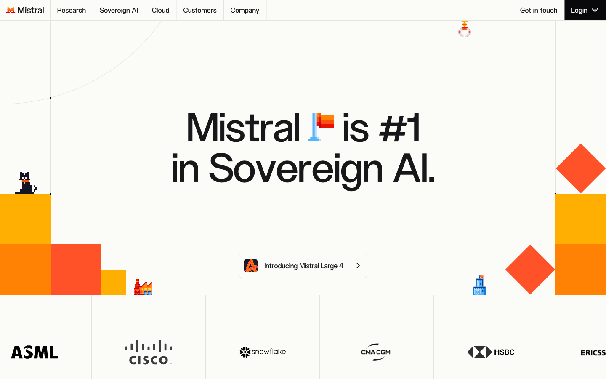
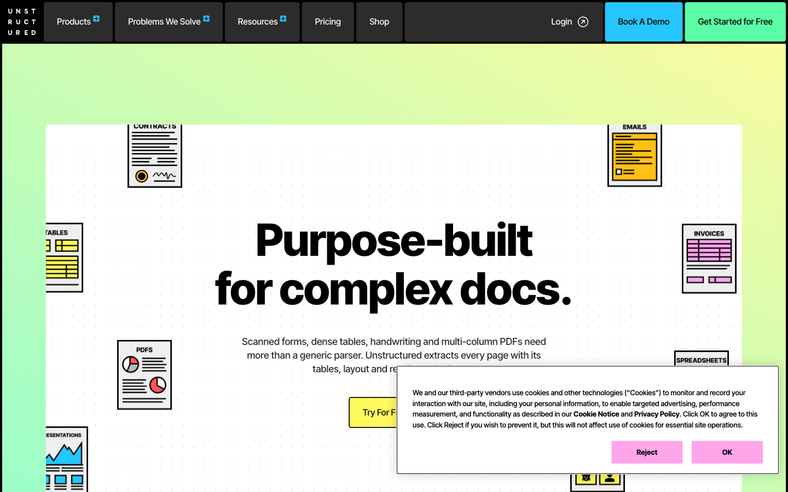
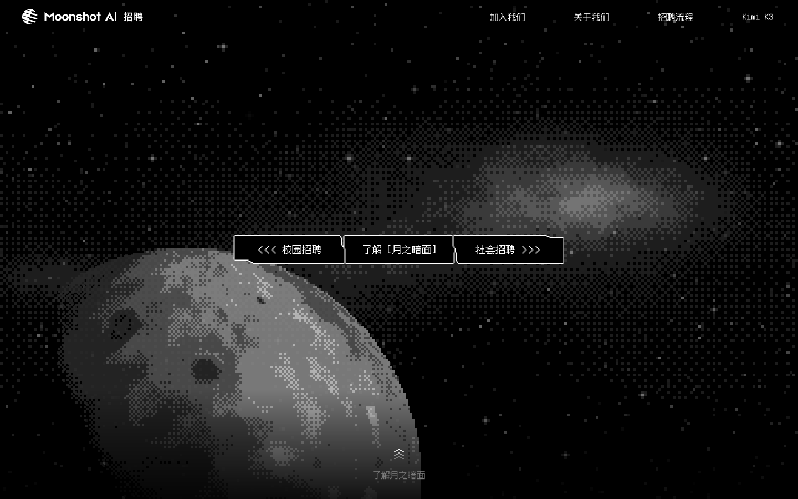

# 个人网站视觉参考与待决策项

更新日期：2026-10-19（Asia/Shanghai）
状态：主视觉、场景范围和信息结构已确认，已有独立可运行样片，待视觉与动效评审
分支：`codex/personal-site-redesign-20261019`，不合并

## 当前设计理解

Design Read：面向招聘方、以网站本身展示审美和交互表达的个人作品集；参考暖白与橙色系、像素角色和几何图形，以整屏场景切换组织浏览。

已确认：求职优先，兼顾接单；不按岗位类别决定表达；多模态倾向；保留顶部导航。网站视觉体现审美与交互表达，具体产品能力由项目内容支撑。

后续逐项确认的决定：

- 首屏主视觉采用原创像素 / 体素水母，延续现有个人标识。
- 全站采用整屏场景切换、滑入滑出和纵深浏览；顶部导航常驻，并支持直接跳转。
- 项目细节点击展开，内容在每幕停稳后阅读。
- 主导航与章节顺序采用：首页 → 作品 → 经历 → 关于我 → 联系。
- 教育并入“关于我”，技能结合项目展示，不再保留单独的教育和技能主导航项。
- 作品章节可以包含多个项目场景，不将整份简历塞进一幕。
- 保留完整中英切换，首次默认中文。
- 主线精选为 Meloscape → 答于言 → PRD 评审助手；其余三个项目在“全部作品”中访问。
- 样片反馈后确认保留几何像素感。取消色块遮罩转场，改为下一幕在当前幕后方逐渐显现、前景渐隐，完成后再交接页面状态。

这些决定允许重排展示层级，不代表经历、项目指标和个人资料的事实内容已被重新核实或授权改写。

用户补充的参考分工：

- [Kimi 招聘站](https://careers.kimi.com/land-on)：学习滑入、滑出和纵深浏览，保留顶部导航。
- [Mistral](https://mistral.ai/)：配色、像素效果以及动画参考。
- [Unstructured](https://unstructured.io/)：动画参考。

这并不等于用户已确认照搬任何一站的整体布局、Logo、角色、文案或素材。

## 本次实际观察

Mistral 与 Unstructured 均已通过独立浏览器上下文成功加载并滚动查看。桌面视口 1440 × 900；补充检查了 Unstructured 的 390 × 844 窄屏布局。最初的直连中断通过本次浏览上下文使用现有系统代理解决，未修改系统网络设置。

### Mistral

- 暖白色大底、近黑文字、黄色至橙红的实色色块构成主要识别。
- 本次 DOM 观察包含 `#FBFBF8`、`#F5F4EF`、`#FFAF01`、`#FF5229`，是原站出现过的颜色，不是个人站已经定稿的 tokens。
- 正文和标题保持清晰的常规字形；像素语言主要出现在角色、旗帜、图标和局部图形。
- 首屏观察到文字遮罩入场、小型像素角色、色块状态变化；旗帜为 GIF 图像，不能把所有动画都归为 WebGL。
- 进入下方章节后，存在文字与图像的透明度切换和横向连续移动元素。部分 CSS 动画观察值为 500ms，只适用于对应元素，不能作为全站统一节奏。
- 此次读取时 Mistral 的首页为 Sovereign AI 主题。未来页面更新后需要重新核对，不能将历史版截图与当前版混用。

来源：[Mistral 官网](https://mistral.ai/)，本次浏览器截图。

### Unstructured

- 本次加载的首页采用近白底、黑色轮廓与粗体标题，局部使用青、绿、粉、黄等鲜艳颜色。
- 首屏有缓慢漂移的云层，内容进场包含较短的位移与淡入。
- 文档章节中，文件插画围绕中央正文错落分布并浮动；文字区域保持主要阅读位置。
- 动态既包括短促的入场，也包括低速循环。观察到首屏入场动画约 350ms，部分背景循环长达数十秒至数分钟，不应混成一个全站统一的快速循环。
- 用户指定它作为动画参考，因此不自动将它的多色按钮、黑色导航块和整套企业官网布局移植到个人站。

来源：[Unstructured 官网](https://unstructured.io/)，本次浏览器截图。右下为原站当次显示的 Cookie 提示。

### Kimi

详细观察见 [Kimi 动效记录](2026-10-19-kimi-motion-reference.md)。重点为整屏舞台、滚动触发的场景过渡、尺度变化带来的纵深、遮罩交接、固定的顶部导航。

来源：[Kimi 招聘站](https://careers.kimi.com/land-on)，本次浏览器截图。

## 建议的组合方式，待用户进一步确认

| 层面 | 主参考 | 建议用于个人站 |
| --- | --- | --- |
| 页面主色与质感 | Mistral | 暖白大底、清楚的深色文字、黄橙红色系点缀；后续从中选择有限的个人配色 |
| 像素表达 | Mistral | 原创角色、像素边缘、几何色块与局部逐帧变化；主体文字继续保障阅读 |
| 章节过渡与纵深 | Kimi | 场景之间安排退出、交接、进入与停稳，导航独立于动画层 |
| 局部生命感 | 两站动画共同参考 | 局部漂浮、错落出现和轻反馈，避免每个元素持续运动 |

候选三项设计参数：`DESIGN_VARIANCE: 8`、`MOTION_INTENSITY: 6`、`VISUAL_DENSITY: 3`。动效强度根据样片反馈从 8 调整为 6，减少覆盖式转场。这些是设计工作参数，不是用户直接指定的数值。

实际实现前仍需明确场景范围与内容安排。涉及导航文字、顺序、章节锚点、Logo 或现有事实内容的修改，应在讨论中明确，不能借视觉升级静默改动。

## 首版可运行样片

首屏主视觉已确定为原创像素 / 体素水母。仓库 `assets/favicon.svg` 已有像素水母标识；现有标识是身份延续的依据，具体新造型仍需通过原型评审。

样片位于 `redesign/`，保留现站入口与部署配置。使用 TypeScript、Vite、Three.js 和 GSAP；角色为独立编写的体素几何与 Shader，imagegen 生成图为风格参考和 WebGL 不可用时的静态备用图。

默认路径七幕：首页、三项精选作品、经历、关于我、联系。导航对应五个章节；项目与完整经历使用原生模态框展开。保留旧 `#education`、`#skills` 的到达映射，统一进入关于我。

语言、中英项目事实和主线顺序已确认。具体造型、文案与转场节奏进入样片评审；移动端采用单列重构，矮屏允许本幕内滚动，减少动态效果设置下取消转场和自动摆动。

未合并、未发布，也未替换根目录 HTML 或 `vercel.json`。

## 观察边界

- 已查看两站实际画面，并读取 DOM、计算样式与部分浏览器动画关键帧辅助分析。
- 没有验收每个 Hover、所有产品演示视频、真实手机触控或设备性能，不宣称完整复刻或完整跨端验收。
- 参考截图仅服务设计讨论；不会作为个人站项目成果、客户背书或原创资产使用。
